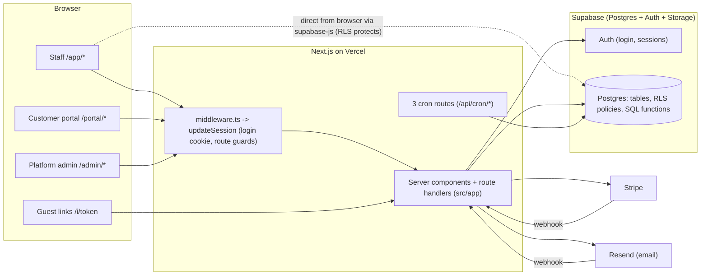

# Project map

Last updated: 2026-11-17. Based on reading code, config and migrations (see "Not inspected yet" at the bottom).
No secrets, tokens or real customer data belong in this file.

## 1. What the app does (simple version)

"Event Manager" (repo name `ronningen-manager`, first customer: Rønningen Selskapslokale) is a web app for venues that rent out rooms for weddings, parties and company events.
Staff track enquiries, bookings, customers, prices, invoices, finance, inventory and overnight stays.
Each venue is one **organization** (a tenant), so many venues can share one app and one database without seeing each other's data.

Who uses it:
- **Staff** (owner, admin, manager, ...) use `/app/*`.
- **Customers** (the people hosting an event) use the customer portal at `/portal/*`: schedule, guest list, invitations, gift wishlist, messages.
- **Guests** open public links such as `/i/[token]` (invitation) without an account.
- **Platform admins** (the people running the SaaS) use `/admin/*`.
- The public landing page is `/`.

## 2. Verified stack

| Thing | Evidence |
|---|---|
| Next.js 16.2.4 (App Router, Turbopack), React 19, TypeScript | `package.json` |
| Supabase: Postgres + Auth (+ Storage, Realtime) | `@supabase/ssr`, `@supabase/supabase-js`, `src/lib/supabase/*`, `supabase/migrations` |
| Tailwind CSS v4, shadcn/ui on Base UI, lucide icons | `package.json`, `components.json` |
| Forms and validation: React Hook Form + Zod | `package.json`, `src/lib/validations*` |
| Server state in the browser: TanStack Query. Small client state: Zustand | `src/lib/queries/*`, `src/store/` |
| Payments: Stripe (subscriptions) | `src/lib/billing/*`, `/api/stripe/webhook`, `/api/webhooks/stripe` |
| Email: Resend (webhook for delivery events) | `/api/webhooks/resend`, `src/lib/portal/mail.ts` |
| Maps: Mapbox address search | `src/lib/mapbox`, `@mapbox/search-js-react` |
| PDFs: pdf-lib | contracts under `src/lib/contracts`, `/api/contracts/*` |
| Tests: Vitest (unit, about 100 test files in `src`), Playwright (1 smoke spec in `e2e/`) | `package.json`, `vitest.config.ts`, `e2e/` |
| CI: GitHub Actions runs typecheck, lint, unit tests | `.github/workflows/ci.yml` |
| Hosting: Vercel (region `arn1`), 3 cron jobs | `vercel.json` |

Database in production (from project memory, not from code): since 2026-11-15 the database is a self-hosted Supabase stack on a Hostinger server, reached at `api.eventmanager.no`. The code only sees it through `NEXT_PUBLIC_SUPABASE_URL`.

## 3. Architecture



Important detail (verified): the staff booking form talks to the database **directly from the browser** with the Supabase client, not through a custom backend. Safety comes from Row Level Security (RLS) and SQL functions in the database.

## 4. Parts table

| Part | Purpose | Connects to | Relevant files |
|---|---|---|---|
| Route guard (middleware) | Reads the login cookie on every request, sends visitors to the right area | Supabase Auth, `src/config/routes.ts` | `src/middleware.ts`, `src/lib/supabase/middleware.ts`, `src/config/routes.ts` |
| Staff app | Dashboard, inquiries, bookings, customers, pricing, finance, invoices, inventory, reports, settings | Supabase, TanStack Query | `src/app/app/*`, `src/components/{bookings,customers,finance,...}` |
| Customer portal | Customer plans their event: schedule, guests, invitation design, gifts, messages | Supabase (column-level grants), Resend | `src/app/portal/*`, `src/components/portal`, `src/lib/portal/*` |
| Guest links | Public invite and RSVP by token, no login | Supabase, token helpers | `src/app/i/[token]`, `src/lib/portal/guest-tokens.ts` |
| Contracts | Rental contract view, email verification, signature, PDF | Supabase, pdf-lib, Resend | `src/app/kontrakt/[token]`, `src/app/api/contracts/*`, `src/lib/contracts` |
| Platform admin | Organizations, users, billing, feature flags, support, audit | Supabase | `src/app/admin/*`, `src/lib/admin/*` |
| Billing | Stripe subscription, trial, access enforcement | Stripe, `subscriptions` table | `src/lib/billing/*`, `src/app/api/{stripe,webhooks/stripe}` |
| Auth APIs | Login, register, one-time code login | Supabase Auth, `login_codes` | `src/app/api/auth/*`, `src/lib/auth/*`, `src/app/auth/confirm/route.ts` |
| Scheduled jobs | Billing enforcement 03:00, contract jobs 04:00, trial reminders 08:00 | Supabase, Stripe, Resend | `vercel.json`, `src/app/api/cron/*` |
| Inbound inquiries | Public endpoint that creates an inquiry | Supabase | `src/app/api/inbound/inquiries/route.ts` |
| Calendar feed | `.ics` calendar for bookings via secret token | Supabase | `src/app/api/calendar/[token]/bookings.ics/route.ts` |
| Database | Tables, RLS, SQL functions, constraints | everything above | `supabase/migrations` (99 files), `src/types/database.types.ts` |
| Translations | Norwegian/English UI text | all components | `src/i18n`, `docs/localization.md` |
| Tests | Unit rules, security checks, one smoke test | code under test | `*.test.ts(x)`, `tests/`, `e2e/` |

## 5. Data (tables seen in migrations)

Tenancy and people: `organizations`, `organization_members`, `organization_invitations`, `profiles`, `customers`, `partners`.
Venue sales: `properties`, `packages`, `services`, `booking_inquiries`, `bookings`, `booking_line_items`, `booking_payment_installments`, `transactions`, `assets`, `accommodation_units`, `accommodation_reservations`.
Contracts: `rental_contracts`, `rental_contract_versions`, `contract_*` (templates, tokens, signing sessions, acceptances, events, jobs, artifacts, email deliveries).
Portal: `portal_accounts`, `portal_guests`, `portal_guest_tokens`, `portal_guest_emails`, `portal_invite_designs`, `portal_activities`, `portal_activity_invitees`, `portal_messages`, `portal_schedule_*`, `portal_wish_*`, `gift_wish_*`.
SaaS: `subscriptions`, `stripe_webhook_events`, `platform_*` (audit, flags, tickets, notifications, impersonation, job runs), `audit_log`, `user_notifications`, `login_codes`.
233 `create policy` / `enable row level security` lines in migrations point to heavy use of RLS (counted by grep, not each policy read).

## 6. Journey 1 (traced): staff creates a booking

Goal: a manager fills the "Ny reservasjon" form and a booking exists, once, without double-booking.

1. **Page.** `/app/bookings/new` is `src/app/app/bookings/new/page.tsx`. It runs on the server. It builds a Supabase server client, gets the organization id (`requireServerOrganizationId`), reads the user's role and redirects to `/app/bookings` unless `canManageBookings(role)` is true. It loads packages, add-ons and customers and passes them to `NewBookingForm`.
2. **Form.** `src/components/bookings/new-booking-form.tsx` is a client component. It uses React Hook Form and the browser Supabase client from `useSupabase()`. Input rules are in `src/lib/validations*`.
3. **Submit.** `handleSubmit` runs the submit function (around lines 480-610). It builds line items and instalments (deposit and remainder), optionally updates the customer's email, then calls `createBookingAtomic(supabase, {...})` with a `client_request_id` created once per form (`clientRequestIdRef`).
4. **Request.** `src/lib/reservations/atomic-create.ts` `callAtomicRpc` calls `supabase.rpc("create_booking_atomic", { payload })`. That is an HTTPS POST to `/rest/v1/rpc/create_booking_atomic` on the database API, with the user's login token in the `Authorization` header.
5. **Permission.** PostgREST (the database's REST layer) puts the user into the `authenticated` role. The SQL function `create_booking_atomic` (latest copy in `supabase/migrations/20261003120000_booking_contract_source_fields.sql`) calls `assert_can_write_reservations(org)`. That raises `forbidden` unless `has_org_role(org, ['owner','admin','manager'])`. The function is `security invoker`, so RLS still applies as the user.
6. **Duplicate protection (idempotency).** The function first looks for a booking with the same `organization_id` and `client_request_id`. If it exists, it returns that booking with `reused: true` instead of inserting again. So a double click or retry does not create two bookings.
7. **Write.** It finds or creates the customer, inserts into `bookings`, `booking_line_items` and `booking_payment_installments`, and can mark a source inquiry as converted. All inside one function call, so it is one database transaction.
8. **Double-booking guard.** The table has an exclusion constraint `bookings_no_double_booking` (migration `20261110150000_double_booking_guard.sql`): same organization and property, overlapping dates, is rejected with SQLSTATE `23P01`.
9. **Response.** JSON with `customerId`, `reservationId`, `reused`, `inquiryConverted`. `parseAtomicResult` checks the shape and throws if ids are missing.
10. **UI update.** Toast "created", `invalidateBookings()` makes TanStack Query refetch the list, `notifyBookingCreated` runs without waiting, a new `client_request_id` is generated, then `redirectAfterCreate` goes to `/app/bookings`.
11. **Failure.** `bookingConflictMessageKey` (in `src/lib/bookings/booking-conflict-error.ts`) maps `23P01` to a translated "date already booked" message. Other errors show `createFailed` with the message. `finally` releases the submit lock.

Sample request body (invented data, shape matches `createBookingAtomic`):

```json
{ "payload": {
  "organization_id": "00000000-0000-0000-0000-000000000001",
  "client_request_id": "11111111-1111-1111-1111-111111111111",
  "customer_name": "Test Person", "customer_email": "test@example.com",
  "property_id": "00000000-0000-0000-0000-0000000000aa",
  "event_type": "Bryllup", "event_date": "2027-06-12", "guest_count": 80,
  "status": "pending", "total_price": 43000, "paid_amount": 10000, "remaining_amount": 33000,
  "line_items": [], "installments": [] } }
```

Sample success response: `{ "customerId": "...", "reservationId": "...", "reused": false, "inquiryConverted": null }`.
Sample failure: HTTP 409 with Postgres code `23P01` (overlap), shown to the user as a translated message.

## 7. Other journeys worth tracing next (not traced yet)

- Customer signs a contract: `/kontrakt/[token]` -> `/api/contracts/verification/*` -> `/api/contracts/signature` -> `/api/contracts/accept`.
- Stripe subscription update: Stripe -> `/api/webhooks/stripe` -> `stripe-webhook-handler.ts` -> `subscriptions` table (webhook, retries, idempotency via `stripe_webhook_events`).
- Customer adds a guest in the portal: `src/lib/portal/guest-actions.ts` and the column-level grants in `20261112140000_customer_portal_accounts.sql`.

## 8. Concepts used here (short glossary)

- **Tenant / multi-tenancy**: many venues share one app; every row has `organization_id`.
- **RLS (Row Level Security)**: the database itself filters rows per user. Not the same as column-level grants (which limit which columns).
- **RPC**: calling a SQL function through the API instead of changing tables directly.
- **Idempotency**: repeating the same request has the same effect as doing it once (`client_request_id`).
- **Server component vs client component**: server components run on the server and can read the database; client components run in the browser and handle clicks.
- **Webhook**: another service (Stripe, Resend) calls our URL when something happens. Normal API calls go the other way.
- **Migration**: a numbered SQL file that changes the database structure step by step.
- **Lazy loading / dynamic import**: `import()` loads a heavy library (three.js in the landing 3D tour) only when it is needed, so the first page load stays small.
- **Canvas texture**: draw 2D on an HTML canvas, then use it as the surface of a 3D object. The landing 3D tour draws each app screen this way.

## 8b. UI building blocks (verified 2026-11-21)

- Tokens: `src/styles/tokens.css` (light and dark). Status colours are `--status-*`; `bg-success` is the brand blue.
- Shared components in `src/components/ui/`: `StatusBadge`, `StatCard`, `SegmentedFilter`, `ViewSwitch`, `DataTable`, `ListPagination`. Pages pass data and handlers; the components own layout and keyboard behaviour.
- `cn()` (`src/lib/utils.ts`) wraps tailwind-merge and knows our `text-app-*` font sizes.
- Rules and status: `docs/design/visual-language.md` (standard) and `docs/design/project-profile.md` (profile, gaps, rollout).
- Guard: `src/lib/design/raw-colors.test.ts` with `raw-colors.baseline.json`.
- Not redesigned yet: Innstillinger, admin pages, onboarding, customer portal (own wedding palette).

## 9. Known differences between docs and code

- `README.md` calls feature screens "minimal placeholders" and lists Recharts as a dependency. The app is much more complete and `recharts` is not in `package.json`. The README is out of date.
- Both `/api/stripe/webhook` and `/api/webhooks/stripe` exist. Not yet checked which one Stripe is configured to call or whether one is a leftover.
- `src/middleware.ts` is used. Next.js 16 may prefer another name for this file; check `node_modules/next/dist/docs/` before changing it (not verified).
- `package.json` scripts `db:push`, `db:seed`, `db:types` are placeholders that only print text.

## 10. Not inspected yet

Admin area internals, Stripe webhook handler body, contract signing and PDF code, cron route bodies, portal guest token security, inbound inquiry endpoint validation, i18n system, landing page, PWA code, calendar feed token handling, RLS policies one by one, `e2e/smoke.spec.ts`, `tests/setup`, and the `scripts/` folder.
